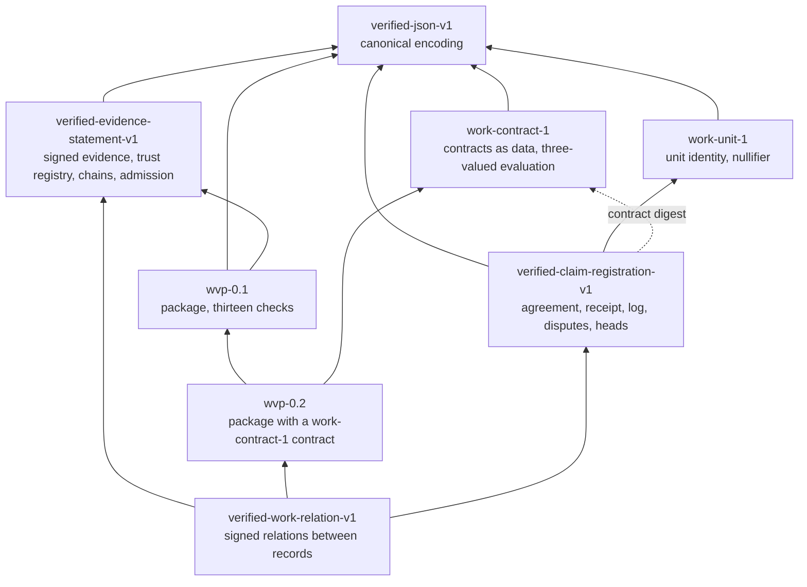

# Architecture of the protocol family

Informative. What exists, what depends on what, what implements it, and where the protocol ends. Read on 2026-10-11; each specification's own header is the authority on itself.

## The specifications

An arrow reads "depends on". Nothing depends on a specification above it, so each layer can be implemented, and reviewed, without those above.

| Identifier                       | Specification                                                       | Defines                                                                                                                                        | Vectors                                              |
| -------------------------------- | ------------------------------------------------------------------- | ---------------------------------------------------------------------------------------------------------------------------------------------- | ---------------------------------------------------- |
| `verified-json-v1`               | [Canonical JSON](../protocols/canonical-json/v1/SPEC.md)            | The one byte form every digest and signature is over                                                                                           | `canonical-hash-v1.json`: 12 valid, 5 invalid        |
| `verified-evidence-statement-v1` | [Evidence Statement v1](../docs/spec/evidence-statement-v1.md)      | A source's signed statement, the relying party's trust registry, chains of statements, admission of evidence for a claim                       | `evidence-statement/v1`: 39                          |
| `wvp-0.1`                        | [WVP v0.1](../protocols/wvp/v0.1/SPEC.md)                           | The package container, thirteen ordered checks, refusal codes, one named evaluator                                                             | `wvp/v0.1`: 26                                       |
| `wvp-0.2`                        | [WVP v0.2](../protocols/wvp/v0.2/SPEC.md)                           | The same container with a contract as data, relying-party expectations, the work record                                                        | `wvp/v0.2`: 28, and 7 expectation cases              |
| `work-contract-1`                | [Work Contract Language 1](../protocols/work-contract/v1/SPEC.md)   | Contracts as typed JSON, evaluated to one of three decisions (`kleene-1`)                                                                      | `work-contract/v1`: 82 cases, 5 differential batches |
| `work-unit-1`                    | [Work-unit identity v1](../protocols/work-unit/v1/SPEC.md)          | Which unit of work a claim is about, and a keyed nullifier for it                                                                              | `work-unit/v1`: 10 identities, 3 key commitments     |
| `verified-claim-registration-v1` | [Claim registration v1](../protocols/claim-registration/v1/SPEC.md) | Registering a claim before evidence is asked for: agreement, receipt, the registry's log, responses, notices, disputes, an audit, signed heads | `claim-registration/v1`: 163 in seven files          |
| `verified-work-relation-v1`      | [Work relation v1](../protocols/work-relation/v1/SPEC.md)           | Signed statements by which a ledger or an application relates records, and what a reader may conclude                                          | `work-relation/v1`: 41                               |

All eight are **Draft** under [RFC 0001](../rfcs/0001-standards-process.md). None is Final.

## Implementations

What reproduces the vectors, as each implementation's own documents state. [`conformance/`](../conformance/README.md) is where an implementation reports this itself.

| Specification                    | Scala reference | JavaScript | Lean 4                                                               | Rust ([`verified-cli`](https://github.com/dekrops/verified-cli)) |
| -------------------------------- | --------------- | ---------- | -------------------------------------------------------------------- | ---------------------------------------------------------------- |
| `verified-json-v1`               | yes             | yes        | no                                                                   | yes                                                              |
| `verified-evidence-statement-v1` | yes             | yes        | no                                                                   | yes                                                              |
| `wvp-0.1`                        | yes             | yes        | a model of one evaluator                                             | yes                                                              |
| `wvp-0.2`                        | yes             | yes        | no                                                                   | yes                                                              |
| `work-contract-1`                | yes             | yes        | the definition of evaluation, with proofs, and a reference evaluator | yes; one case file cannot be represented                         |
| `work-unit-1`                    | yes             | yes        | no                                                                   | yes                                                              |
| `verified-claim-registration-v1` | yes             | yes        | a model of the registry's states                                     | yes, except signed heads                                         |
| `verified-work-relation-v1`      | yes             | no         | no                                                                   | yes                                                              |
| **Public**                       | no              | no         | no                                                                   | yes                                                              |

The Scala reference generates every vector. It and the JavaScript are the steward's and are not public. The Lean definitions are published in this repository and checked by its CI. The Python and TypeScript SDKs bind the Rust crates; under RFC 0001 section 8.2 a binding counts once, with what it binds.

So, today, every specification has one implementation that an outsider can read and run, the contract language has a second in Lean, and the implementation that generates the expectations is not public. [The audit](normative-audit-2026-10.md) takes this up.

## Where the protocol ends

The protocol is what a party needs in order to check another party's objects **offline, under its own keys**: encodings, objects, signing inputs, checks and their order, refusal codes, and the vectors.

These are not protocol, and no specification here may come to depend on them:

| Not protocol                                                                 | Why not                                                                                                                                    |
| ---------------------------------------------------------------------------- | ------------------------------------------------------------------------------------------------------------------------------------------ |
| **Persistence**: ledgers, databases, how a registry stores its log           | A verifier is given objects. Where they were kept is not something it can check                                                            |
| **Service interfaces**: HTTP routes, authentication, tenancy of a deployment | Two parties interoperate through objects, not through one party's service                                                                  |
| **Evidence gateways and connectors**                                         | How a source reads its system of record is the source's business. The protocol begins at the statement it signs                            |
| **The claim registry as a service**                                          | The protocol defines what a registry signs and what a relying party checks. Running one, its availability and its operations are a product |
| **User interfaces, explanations, review workflows**                          | They present results. They decide nothing a verifier reproduces                                                                            |
| **Operational monitoring, deployment, key custody**                          | Real, and necessary, and outside what an object can prove                                                                                  |
| **Command-line tools and SDK interfaces**                                    | Exit codes, flags and API shapes belong to each implementation                                                                             |

Two things sit near the line and are named so that they are not mistaken:

- **The trust registry format** is protocol: a verifier's result depends on it. Its content is the relying party's alone, and never part of a verified object.
- **A work record** is protocol (`wvp-0.2`, section 7): a statement about a package that anyone can recompute. A ledger that keeps work records is not.

## What the family cannot establish

Stated once here because every specification says it of itself. Verification establishes who said what, that it was not altered, that the signer was authorized by the relying party for its source, and what a contract yields from the evidence presented. It does not establish that a source told the truth, that the evidence presented is all the evidence there is, that a contract was the right definition of the work, or that anything was accepted, paid or final.
